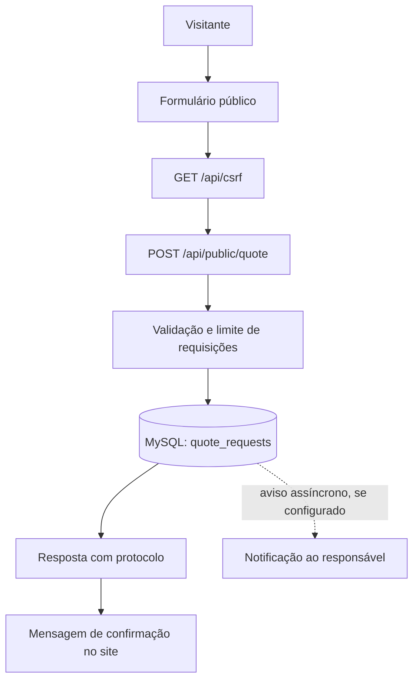

# B2B Inteligente — arquitetura e infraestrutura

**Documento:** ARQ-001  
**Revisão:** 1.1  
**Data da análise:** 30/10/2026  
**Base:** código recebido em `b2binteligente-codigos.zip` e resumo do projeto fornecido.

## 1. Objetivo

Registrar a arquitetura encontrada no projeto antes das próximas alterações. Este documento separa o que já está implementado do que está planejado. Uma funcionalidade marcada como planejada não deve ser apresentada como pronta.

## 2. Visão geral atual

O B2B Inteligente possui três áreas principais:

1. **Site público:** apresenta a proposta de logística de importação, oferece o B2B Assistente e recebe solicitações de contato/cotação.
2. **Área interna:** permite que funcionários e administradores autenticados consultem solicitações e utilizem o painel operacional.
3. **Serviços de backend:** fornecem autenticação, autorização, persistência MySQL, integração com IA do painel e notificação ao responsável.

Clientes não possuem conta, login ou rastreamento de cargas nesta fase.

## 3. Tecnologias identificadas

| Camada | Tecnologia / componente | Uso atual |
|---|---|---|
| Runtime | Node.js 22+ | Execução do servidor |
| Backend | Express 5.1.0 | Rotas HTTP, middleware e regras de negócio |
| Banco de dados | MySQL gerenciado | Usuários, sessões, cotações e auditoria |
| Driver SQL | mysql2 3.14.4 | Pool e consultas parametrizadas |
| Limitação de requisições | express-rate-limit 8.2.1 | Proteção de login, cotação e IA interna |
| Frontend | HTML, CSS e JavaScript | Site público e telas internas |
| Gerenciador de pacotes | pnpm 11.25.0 | Instalação e scripts do projeto |
| IA interna | API da plataforma Manus, chamada pelo servidor | Assistente operacional interno, com contexto demonstrativo |
| IA pública | `src/public-assistant.mjs` + API Manus opcional, chamada pelo servidor | Base institucional aprovada e respostas determinísticas; IA para perguntas abertas quando configurada |

Não há etapa de compilação do frontend identificada: os arquivos HTML, CSS e JavaScript são servidos diretamente.

## 4. Estrutura de diretórios

```text
b2binteligente/
├── docs/                 # Documentação técnica e histórico
├── migrations/           # Migrações SQL versionadas (001 e 002)
├── private/              # HTML das telas internas (não servido como estático)
├── public/               # Site, login e arquivos públicos
│   └── assets/           # CSS, JavaScript e imagens (inclui chatbot.css/chatbot.js)
├── scripts/              # Rotinas administrativas, como criação do primeiro admin
├── src/                  # Backend, banco, segurança, IA e notificações
├── test/                 # Testes automatizados
├── .env.example          # Nomes e exemplos de configuração, sem segredos reais
├── package.json          # Scripts e dependências
├── README.md             # Instruções principais
└── TODO.md               # Pendências e entregas
```

## 5. Componentes e responsabilidades

### 5.1 Site público

- Página inicial: `public/index.html`.
- Estilos: `public/assets/site.css`.
- Interações e formulário de cotação: `public/assets/site.js`.
- Widget público: `public/assets/chatbot.js` e `public/assets/chatbot.css`.
- O formulário envia os dados para `POST /api/public/quote`.
- O chatbot usa `POST /api/public/chatbot` para perguntas e reutiliza `POST /api/public/quote` para registrar cotações confirmadas.
- O formulário solicita um token CSRF antes do envio.
- O frontend exibe o protocolo curto retornado pelo backend após o registro.

### 5.2 Área interna

- Dashboard: `private/dashboard.html` e `public/assets/dashboard.js`.
- Solicitações: `private/requests.html` e `public/assets/requests.js`.
- Usuários: `private/users.html` e `public/assets/users.js`.
- Acesso corporativo: `public/login.html` e `public/assets/login.js`.
- O servidor verifica a sessão antes de entregar as páginas internas.
- A gestão de usuários é restrita ao perfil `admin`.

### 5.3 Backend

Arquivo principal: `src/server.mjs`.

Responsabilidades atuais:

- servir arquivos públicos;
- aplicar cabeçalhos básicos de segurança;
- validar sessão, CSRF e permissões;
- receber e validar solicitações públicas;
- consultar e atualizar solicitações na área interna;
- administrar usuários;
- disponibilizar o assistente operacional interno;
- iniciar as migrações do banco e o servidor HTTP.

### 5.4 Banco de dados

- Conexão e migração: `src/db.mjs`.
- Migrações: `migrations/001_initial.sql` e `migrations/002_quote_submission_channel.sql`.
- O servidor executa as migrações pendentes no início e usa bloqueio nomeado do MySQL para evitar execução concorrente da rotina.
- A tabela `schema_migrations` registra a versão aplicada.

### 5.5 IA e notificações atuais

- `src/assistant.mjs`: chama a API de IA no servidor para o assistente do painel. O contexto usado é explicitamente fictício.
- `src/public-assistant.mjs`: responde dúvidas institucionais aprovadas e, quando configurada, chama a API de IA pelo servidor para perguntas abertas. Não consulta o banco de dados.
- `src/notifications.mjs`: envia uma notificação ao responsável pela plataforma Manus quando uma nova cotação é registrada e o serviço está configurado; a mensagem identifica se a origem foi o formulário ou o chatbot.
- **A notificação atual não é um Webhook HTTP genérico.** Um Webhook externo será uma integração separada, planejada e ainda não implementada nesta revisão.

## 6. Fluxo atual de uma cotação pelo site



A confirmação significa que o sistema recebeu e registrou a solicitação. Não significa que uma cotação comercial foi calculada ou aprovada.

## 7. Rotas identificadas

### 7.1 Páginas

| Rota | Acesso | Comportamento |
|---|---|---|
| `/` | Público | Site institucional |
| `/login` | Público, com redirecionamento se já autenticado | Login da equipe |
| `/internal` | Funcionário ou administrador | Dashboard |
| `/internal/requests` | Funcionário ou administrador | Solicitações recebidas |
| `/internal/users` | Administrador | Gestão de usuários |

### 7.2 API

| Método | Rota | Acesso | Finalidade |
|---|---|---|---|
| GET | `/healthz` | Público | Verificação simples de saúde |
| GET | `/api/csrf` | Público | Emissão de token CSRF |
| POST | `/api/auth/login` | Público + CSRF | Autenticar equipe |
| GET | `/api/auth/me` | Sessão válida | Consultar usuário autenticado |
| POST | `/api/auth/logout` | CSRF | Encerrar sessão |
| POST | `/api/public/quote` | Público + CSRF + limite | Registrar solicitação de cotação e canal de origem |
| POST | `/api/public/chatbot` | Público + CSRF + limite | Responder dúvidas institucionais; não consulta dados privados |
| GET | `/api/internal/requests` | Equipe autenticada | Listar solicitações |
| PATCH | `/api/internal/requests/:id` | Equipe autenticada + CSRF | Alterar status da solicitação |
| GET | `/api/admin/users` | Administrador | Listar usuários |
| POST | `/api/admin/users` | Administrador + CSRF | Criar usuário |
| PATCH | `/api/admin/users/:id` | Administrador + CSRF | Atualizar usuário |
| POST | `/api/internal/assistant` | Equipe autenticada + CSRF + limite | Consultar IA operacional demonstrativa |

## 8. Controles de segurança encontrados

- Senhas derivadas com `scrypt`; o texto da senha não é armazenado.
- Token de sessão aleatório; somente o hash SHA-256 é persistido.
- Sessões expiram após 12 horas.
- Cookie de sessão `HttpOnly`; em HTTPS usa `Secure` e `SameSite=None` conforme configuração atual.
- Proteção CSRF por cookie e cabeçalho comparados em tempo constante.
- Verificação de autenticação e autorização no servidor.
- Gestão de usuários restrita a administradores.
- Limite atual: login 10 tentativas/15 min; cotação 5 envios/15 min; IA interna 12 mensagens/min; chatbot público 10 mensagens/min.
- Consultas SQL com parâmetros nas operações examinadas.
- Cabeçalhos `X-Content-Type-Options`, `Referrer-Policy` e `Permissions-Policy`.

A presença desses controles não substitui uma revisão de segurança antes de produção.

## 9. Configuração de ambiente

| Variável | Obrigatória / opcional | Uso |
|---|---|---|
| `PORT` | Opcional | Porta HTTP; padrão 3000 |
| `DATABASE_URL` | Obrigatória | Conexão MySQL |
| `DRIZZLE_DATABASE_URL` | Alternativa | URL MySQL usada como fallback pelo código |
| `MANUS_API_URL` | Necessária para recursos atuais da plataforma | Base da API Manus |
| `MANUS_API_KEY` | Necessária para recursos atuais da plataforma | Credencial privada, somente no servidor |
| `ALLOWED_EMAIL_DOMAINS` | Opcional, recomendada após confirmação dos domínios reais | Lista de domínios autorizados para contas internas |
| `COOKIE_TRANSPORT` | Opcional | `http-local` somente para desenvolvimento HTTP local |

Não colocar valores reais de credenciais no Git, no frontend ou nesta documentação. Usar variáveis protegidas ou cofre de segredos do ambiente de execução.

### Atenção sobre cookies

`COOKIE_TRANSPORT=http-local` não deve ser usado em Preview HTTPS nem em produção. O comportamento padrão do código é adequado ao cenário HTTPS/Preview descrito no README.

### Primeiro administrador

Não há conta padrão. O primeiro administrador é criado por `pnpm admin:create`, em terminal seguro conectado ao banco. O domínio corporativo real ainda precisa ser informado para configurar `ALLOWED_EMAIL_DOMAINS` caso a empresa queira essa restrição.

## 10. Estado da infraestrutura e itens que precisam de definição

| Item | Estado observado | Próxima ação |
|---|---|---|
| Banco MySQL | Configuração por variável de ambiente | Confirmar provedor, ambiente e política de backup |
| Domínio público | Não publicado no material recebido | Definir domínio e HTTPS antes de produção |
| Domínios de e-mail corporativo | Não informados; variável vazia no exemplo | Obter lista oficial antes de restringir contas |
| IA | Assistente interno e chatbot público usam a API da plataforma no servidor quando configurada; chatbot também possui respostas locais aprovadas | Definir limites/custo e validar a configuração no ambiente final |
| Notificação ao responsável | Serviço Manus, opcional por configuração | Validar destinatário e comportamento no ambiente final |
| Webhook externo | Não implementado | Escolher sistema receptor e contrato do evento |
| Monitoramento e alertas | Não documentados no projeto recebido | Definir ferramenta, alertas e responsável |
| Backup e restauração | Não documentados no projeto recebido | Definir frequência, retenção e teste de restauração |
| Política de retenção de dados | Não informada | Definir prazo e procedimento de exclusão com a empresa |

## 11. Chatbot público implementado

O chatbot é uma funcionalidade pública separada do assistente interno.

- Está incorporado ao site público como widget de conversa em `public/index.html`; o estilo fica isolado em `public/assets/chatbot.css` e a interação em `public/assets/chatbot.js`.
- A identidade visual do projeto utiliza `public/assets/logo.svg`, um recurso vetorial leve compartilhado pelas páginas públicas e internas.
- Não exigirá login do cliente.
- Usa `POST /api/public/chatbot`, com validação de histórico, CSRF e limite de 10 mensagens por minuto.
- A base da IA contém somente conteúdo institucional aprovado sobre a empresa e o processo de cotação. As três perguntas principais têm respostas determinísticas que não dependem de credenciais externas.
- Não terá acesso a usuários, sessões internas, pedidos de outros clientes, dashboard ou dados operacionais demonstrativos.
- Orienta o cliente e inicia um fluxo guiado de cotação. Os dados são coletados no navegador, não enviados ao endpoint de IA, e só seguem para o backend depois da confirmação do visitante.
- Quando a cotação é confirmada, o backend reutiliza a validação e persistência de `POST /api/public/quote`, registrando `submission_channel = chatbot`. O formulário tradicional registra `website_form`.
- O cliente receberá um protocolo de recebimento, nunca uma promessa de cotação calculada ou rastreamento.
- Se a IA estiver indisponível, as respostas institucionais principais continuam disponíveis pela base local e o formulário tradicional permanece acessível. Se o backend falhar ao gravar a cotação, nenhum protocolo é apresentado.

O Webhook externo ainda não está conectado. O evento candidato é `quote.created`, após persistência bem-sucedida. A integração externa depende da URL receptora, método de autenticação/assinatura, política de repetição e responsável fornecidos pela empresa. A notificação Manus existente permanece uma integração distinta.

## 12. Infraestrutura e pendências externas

- O chatbot não exige novo serviço de hospedagem: roda no mesmo frontend estático e backend Express.
- A chamada de IA é server-side e reutiliza `MANUS_API_URL` e `MANUS_API_KEY`, quando configuradas. Nenhuma chave é enviada ao navegador.
- A migration `002_quote_submission_channel` é executada automaticamente pelo mecanismo versionado no início do servidor.
- Não foi realizado teste contra o MySQL remoto nem contra a API Manus neste ambiente de auditoria.
- O Webhook externo não pode ser ativado sem URL de destino e segredo/configuração definidos pela empresa.

## 13. Limites desta documentação

Esta revisão descreve o código recebido. O ZIP não contém a pasta `.git`; a identificação `main` e o commit `93e1cf4` constam do resumo de entrega fornecido, mas não puderam ser verificados localmente. Também não foi possível validar credenciais, banco remoto, notificações ou publicação em produção.
