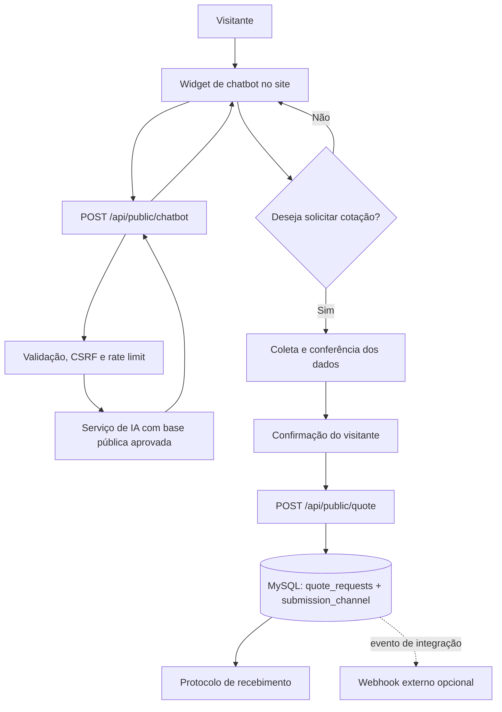

# B2B Inteligente — fluxos e comportamento esperado do site

**Documento:** FLX-001  
**Revisão:** 1.1  
**Data:** 30/10/2026

## 1. Princípio geral

O site público deve explicar os serviços e permitir que uma empresa inicie contato ou solicite uma cotação. A área interna deve permanecer exclusiva da equipe. O chatbot público é um canal adicional de orientação e captação, não um sistema de rastreamento nem um canal de consulta a informações internas.

## 2. Comportamento atual

### 2.1 Visitante no site

1. Acessa `/` sem autenticação.
2. Navega pelas seções de soluções, processo, empresa e dúvidas.
3. Pode preencher o formulário de cotação.
4. O navegador solicita um token CSRF.
5. O backend valida os campos, aplica limite de requisições e grava a solicitação.
6. O site mostra mensagem de recebimento e protocolo curto.
7. Se a notificação da plataforma estiver configurada, o responsável recebe um aviso. Esse aviso não é uma confirmação enviada ao cliente.

### 2.2 Equipe

1. Acessa `/login`.
2. Informa e-mail e senha corporativos cadastrados por administrador.
3. O backend valida a conta e cria uma sessão.
4. Funcionários e administradores acessam o dashboard e as solicitações.
5. Somente administradores acessam a gestão de usuários.
6. O usuário pode encerrar a sessão.

### 2.3 Assistente interno

- Está disponível somente dentro do painel autenticado.
- Usa contexto fictício de demonstração.
- Deve deixar claro que os indicadores e pedidos são demonstrativos.
- Não deve ser reutilizado como fonte de informações públicas sobre a empresa.

## 3. Comportamento implementado do chatbot público

### 3.1 Abertura

- Exibe um botão flutuante acessível na página pública.
- Ao clicar, abre uma janela de conversa sem redirecionar o visitante.
- Exibe uma saudação e explica que o assistente orienta sobre importação e solicitações de cotação.
- Funciona em desktop e celular; no celular abre uma janela compacta posicionada acima do botão flutuante, sem abrir o teclado automaticamente.
- Oferece controles para fechar e reabrir a conversa.

### 3.2 Perguntas e respostas iniciais

O chatbot responde, com base em conteúdo aprovado, pelo menos:

1. **Quais informações preciso para importar um produto?**  
   Orientar o visitante a informar país de origem, descrição do produto/carga, destino no Brasil e volume aproximado, se souber. A equipe poderá solicitar detalhes adicionais.

2. **Como faço para solicitar uma cotação?**  
   Explicar que o assistente pode iniciar a coleta de dados ou direcionar ao formulário. A solicitação só será registrada após o envio e validação pelo servidor. O registro não é uma cotação final.

3. **Como faço para acompanhar minha solicitação?**  
   Explicar que a equipe poderá entrar em contato pelos dados fornecidos. Não oferecer rastreamento de cargas, consulta de status online ou login de cliente nesta fase.

### 3.3 Fluxo guiado de cotação implementado

Quando o visitante escolher iniciar uma cotação:

1. Explicar quais dados serão solicitados e a finalidade de uso.
2. Coletar nome de contato, empresa, e-mail, telefone, país de origem, produto/tipo de carga e destino no Brasil.
3. Coletar volume aproximado e detalhes adicionais como opcionais.
4. Mostrar um resumo para conferência antes do envio.
5. Solicitar confirmação expressa do visitante antes de enviar os dados.
6. Enviar os dados ao backend; o navegador não grava diretamente no MySQL.
7. O backend valida e persiste na tabela `quote_requests`, com `submission_channel = chatbot`.
8. Em caso de sucesso, mostrar protocolo e explicar que a equipe poderá retornar.
9. Em caso de falha, preservar os dados no estado da conversa enquanto a página estiver aberta e oferecer nova tentativa ou formulário tradicional.

Os nomes, e-mail e telefone devem ser tratados como dados pessoais. O chatbot não deve pedir senha, dados bancários, documentos pessoais ou informações que não sejam necessárias para iniciar a cotação.

### 3.4 Limites de conhecimento e segurança

- Responder apenas sobre conteúdo institucional aprovado, processo geral de cotação e orientações já publicadas.
- Não inventar rotas atendidas, prazos, preços, garantias, certificações, clientes, cobertura geográfica ou condições comerciais.
- Não apresentar os dados fictícios do dashboard como dados reais.
- Não consultar solicitações de outros clientes.
- Não acessar nem revelar dados internos, usuários, sessões, credenciais ou auditoria.
- Não confirmar reserva de transporte, despacho, embarque, entrega ou cotação comercial.
- Quando não souber, informar a limitação e direcionar ao formulário/equipe.
- A chave da IA deve permanecer no servidor.
- Limitar volume e frequência de mensagens (10 por minuto por IP) e validar o conteúdo recebido. O backend considera apenas as últimas oito mensagens, com até 1.000 caracteres por mensagem.

### 3.5 Indisponibilidade

Se o serviço de IA falhar:

- mostrar mensagem simples de indisponibilidade;
- não exibir stack trace, credenciais ou erro interno;
- manter o formulário público de cotação acessível;
- permitir que o visitante continue pelo formulário tradicional.

Se o backend não conseguir salvar uma cotação:

- não apresentar protocolo;
- informar que o envio não foi concluído;
- permitir tentar novamente;
- não afirmar que a equipe recebeu os dados.

## 4. Fluxo técnico implementado

O fluxo do Webhook será habilitado somente quando houver um sistema receptor e uma URL fornecidos pela empresa. A notificação Manus atual não deve ser descrita como esse Webhook.

## 5. Critérios de aceite e validação do chatbot

Os itens marcados como implementados refletem o código e os testes automatizados locais. A validação visual em navegador e a integração com MySQL/IA devem ser concluídas no ambiente de execução antes da publicação.

- [ ] Validar visualmente no navegador que o widget abre, fecha e reabre corretamente.
- [ ] Validar visualmente o layout em desktop e celular.
- [x] As três perguntas da atividade têm respostas coerentes.
- [x] Respostas não inventam dados comerciais.
- [x] O chatbot não exige login do cliente.
- [x] O chatbot não acessa o dashboard nem solicitações alheias.
- [x] A IA é chamada exclusivamente pelo backend.
- [x] Existe limite de requisições e validação de entrada.
- [ ] O fluxo guiado mostra resumo e pede confirmação antes de enviar.
- [ ] Confirmar em banco de desenvolvimento que a cotação via chatbot é gravada no mesmo fluxo seguro de persistência.
- [ ] Aplicar a migration em banco de desenvolvimento e confirmar a origem da solicitação na lista interna.
- [x] Protocolo só aparece após confirmação de gravação pelo backend.
- [x] Falha de IA não impede o uso do formulário tradicional.
- [x] A documentação e os testes são atualizados junto com a implementação.

## 6. Webhook candidato e limite atual

O evento candidato para uma integração externa é `quote.created`, emitido somente depois que `quote_requests` confirmar a gravação. Um receptor externo poderá receber o identificador da solicitação, empresa, resumo da carga, canal de origem e data do evento. Dados pessoais completos não devem ser enviados por padrão.

A entrega por Webhook ainda não está ativa porque a empresa não informou URL receptora, sistema de destino, autenticação/segredo, política de repetição ou responsável. A notificação Manus atual não é considerada esse Webhook.
