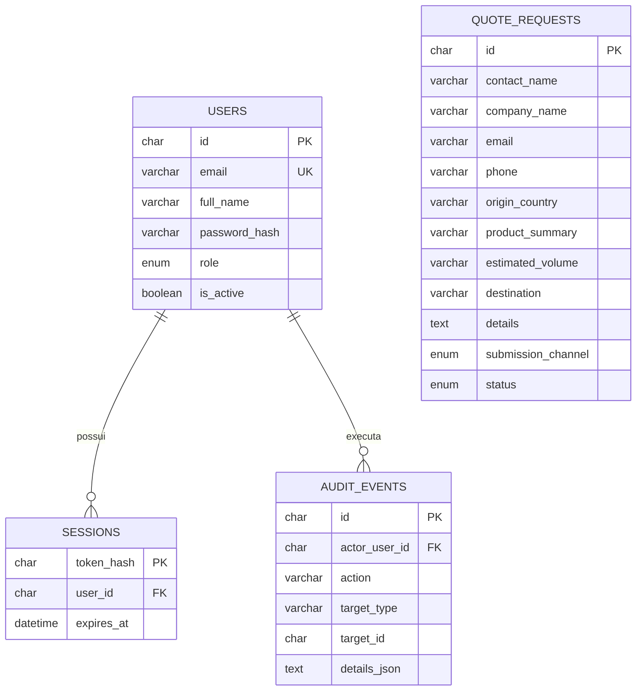

# B2B Inteligente — modelo e dicionário de dados

**Documento:** DAD-001  
**Revisão:** 1.1  
**Data da análise:** 30/10/2026  
**Fonte:** `migrations/001_initial.sql` e consultas de `src/server.mjs`.

## 1. Objetivo

Descrever as tabelas existentes, seus campos, relacionamentos, finalidade e cuidados de uso. Este documento representa o esquema encontrado no código recebido; não confirma o estado de um banco remoto.

## 2. Visão das entidades

`schema_migrations` também é criada pelo mecanismo de migração para registrar versões aplicadas.

## 3. Dicionário de dados

### 3.1 `users` — contas internas

| Campo | Tipo SQL | Obrigatório | Finalidade / observação |
|---|---|---:|---|
| `id` | CHAR(36) | Sim | Identificador UUID, chave primária |
| `email` | VARCHAR(254) | Sim | E-mail de acesso; único |
| `full_name` | VARCHAR(120) | Sim | Nome do funcionário/administrador |
| `password_hash` | VARCHAR(256) | Sim | Hash `scrypt`; nunca armazenar senha em texto |
| `role` | ENUM('employee','admin') | Sim | Perfil de autorização; padrão `employee` |
| `is_active` | TINYINT(1) | Sim | Conta ativa ou desativada; padrão 1 |
| `created_at` | DATETIME | Sim | Data de criação |
| `updated_at` | DATETIME | Sim | Última atualização automática |
| `last_login_at` | DATETIME | Não | Último login bem-sucedido |

### 3.2 `sessions` — sessões autenticadas

| Campo | Tipo SQL | Obrigatório | Finalidade / observação |
|---|---|---:|---|
| `token_hash` | CHAR(64) | Sim | Hash SHA-256 do token; chave primária |
| `user_id` | CHAR(36) | Sim | Conta vinculada; FK para `users.id` |
| `expires_at` | DATETIME | Sim | Expiração da sessão |
| `created_at` | DATETIME | Sim | Data de criação |

A exclusão de um usuário remove suas sessões por `ON DELETE CASCADE`. O token original não é persistido no banco.

### 3.3 `quote_requests` — solicitações públicas

| Campo | Tipo SQL | Obrigatório | Finalidade / observação |
|---|---|---:|---|
| `id` | CHAR(36) | Sim | Identificador UUID, chave primária |
| `contact_name` | VARCHAR(120) | Sim | Nome da pessoa de contato |
| `company_name` | VARCHAR(160) | Sim | Empresa interessada |
| `email` | VARCHAR(254) | Sim | E-mail para retorno |
| `phone` | VARCHAR(40) | Sim | Telefone para retorno |
| `origin_country` | VARCHAR(100) | Sim | País de origem informado |
| `product_summary` | VARCHAR(240) | Sim | Produto ou tipo de carga |
| `estimated_volume` | VARCHAR(120) | Não | Volume aproximado informado |
| `destination` | VARCHAR(120) | Sim | Destino no Brasil |
| `details` | TEXT | Não | Observações adicionais |
| `submission_channel` | ENUM('website_form','chatbot') | Sim | Canal de entrada; padrão `website_form` para compatibilidade com registros anteriores |
| `status` | ENUM('new','reviewing','contacted','closed') | Sim | Etapa interna; padrão `new` |
| `created_at` | DATETIME | Sim | Data de recebimento |
| `updated_at` | DATETIME | Sim | Última atualização automática |

Índices existentes: `(status, created_at)` e `company_name`.

**Dados pessoais e empresariais:** nome, e-mail e telefone são dados pessoais de contato; os demais campos podem revelar informações comerciais da empresa e da operação. O acesso deve permanecer restrito à equipe autorizada.

**Origem do registro:** `submission_channel` identifica o canal de entrada. `website_form` representa o formulário tradicional e `chatbot` representa o fluxo guiado do B2B Assistente. A migration `002_quote_submission_channel.sql` adiciona o campo com padrão `website_form`, preservando e classificando os registros que já existiam antes da mudança.

### 3.4 `audit_events` — auditoria administrativa

| Campo | Tipo SQL | Obrigatório | Finalidade / observação |
|---|---|---:|---|
| `id` | CHAR(36) | Sim | Identificador UUID, chave primária |
| `actor_user_id` | CHAR(36) | Não | Usuário responsável; FK para `users.id` |
| `action` | VARCHAR(80) | Sim | Ação registrada |
| `target_type` | VARCHAR(60) | Sim | Tipo do objeto afetado |
| `target_id` | CHAR(36) | Não | Identificador do objeto afetado |
| `details_json` | TEXT | Não | Detalhes adicionais em JSON serializado |
| `created_at` | DATETIME | Sim | Data do evento |

A FK usa `ON DELETE SET NULL`, preservando o evento mesmo se a conta do ator for removida. Não registrar senhas, tokens, chaves ou conteúdo integral de conversas neste campo.

### 3.5 `schema_migrations` — controle de versões do esquema

| Campo | Tipo SQL | Obrigatório | Finalidade |
|---|---|---:|---|
| `version` | VARCHAR(64) | Sim | Identificador da migração aplicada; chave primária |
| `applied_at` | DATETIME | Sim | Data de aplicação |

A tabela é criada por `src/db.mjs` e recebe a versão `001_initial` após a execução da migração inicial.

## 4. Relacionamentos e regras

- Um usuário pode possuir várias sessões.
- Uma sessão pertence a um usuário.
- Um usuário pode gerar vários eventos de auditoria.
- Uma solicitação de cotação não está vinculada a uma conta de cliente, pois clientes não possuem login nesta fase.
- O status da solicitação é controlado pela equipe: `new`, `reviewing`, `contacted` ou `closed`.

## 5. Classificação e acesso

| Grupo | Classificação operacional | Acesso esperado |
|---|---|---|
| Usuários e sessões | Restrito / autenticação | Backend e administradores autorizados |
| Solicitações de cotação | Dados pessoais e comerciais | Funcionários e administradores autenticados |
| Canal de origem da cotação | Metadado operacional | Equipe autenticada; exibido na lista interna de solicitações |
| Auditoria | Restrito | Backend e responsáveis autorizados |
| Conteúdo institucional aprovado | Público | Visitantes e chatbot público |
| Indicadores e pedidos fictícios do painel | Demonstrativo | Equipe autenticada; não apresentar como operação real |

## 6. Regras de integridade e validação atuais

- E-mails são normalizados para minúsculas e validados no backend.
- Senhas internas devem ter de 14 a 128 caracteres ao criar/alterar contas.
- Perfis aceitos: `employee` e `admin`.
- O sistema impede desativar a própria conta.
- O sistema impede remover/desativar o último administrador ativo.
- Solicitações exigem nome, empresa, e-mail válido, telefone, país de origem, produto e destino.
- O backend limita os comprimentos dos campos antes da persistência.
- Consultas usam parâmetros SQL nas operações examinadas.

## 7. Pontos de evolução de dados

| Item | Situação | Diretriz para a evolução |
|---|---|---|
| Canal de entrada da cotação | Implementado | `submission_channel` diferencia `website_form` e `chatbot`; registros anteriores recebem `website_form` |
| Consentimento/aviso de privacidade | Existe texto informativo no formulário, sem campo de aceite persistido | Definir texto, versão e forma de registro com responsável pela empresa antes de alterar o banco |
| Retenção e exclusão | Prazo não informado | Definir política de retenção, descarte e atendimento aos titulares |
| Histórico de mensagens do chatbot | Não existe | Não persistir conversa completa por padrão; registrar apenas o necessário para operação e segurança |
| Dados de embarque/rastreamento | Não existem | Fora do escopo desta fase; não prometer rastreamento ao cliente |
| Dados reais do dashboard | Ainda demonstrativos | Só substituir após definição e integração com fonte operacional autorizada |

## 8. Regras para futuras migrações

1. Nunca editar uma migration já aplicada em ambiente compartilhado/produção.
2. Criar novo arquivo numerado, por exemplo `002_descricao.sql`.
3. Preferir alterações aditivas e compatíveis com os registros existentes.
4. Definir valores padrão para novas colunas obrigatórias em tabelas já populadas.
5. Testar em banco de desenvolvimento antes de aplicar em produção.
6. Documentar impacto, reversão possível e validação pós-migração.
7. Não colocar dados reais ou credenciais nos arquivos SQL versionados.
